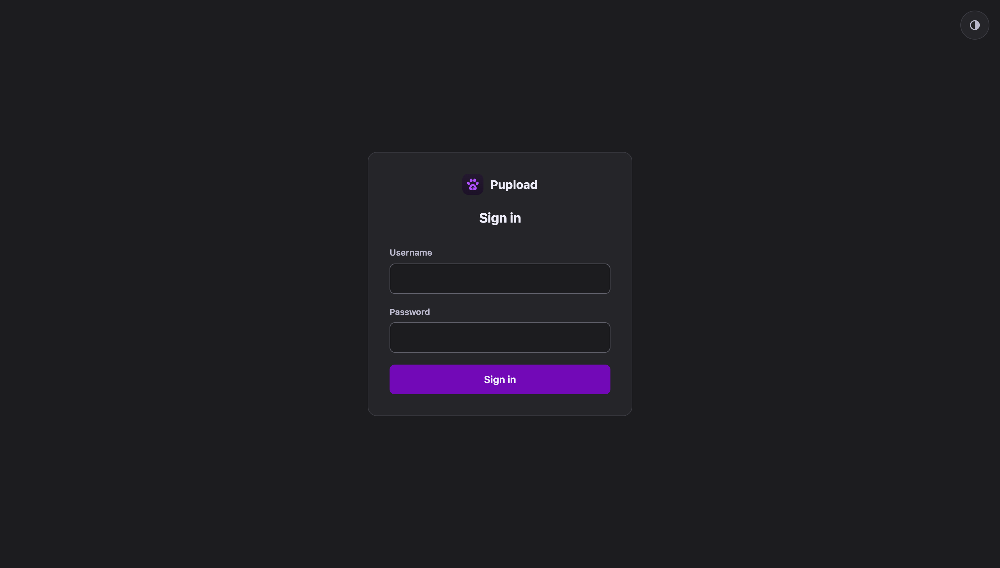

# Pupload(-server)

This is a self hosted docker image designed to run on a Raspberry Pi 5 to backup your iOS iCloud photos to your own storage. All your photos and data, backed up and filed away.



Features:

* iCloud aware -- Syncs iOS photo data, including the cloud ID to avoid backing up each photo multiple times
* Stable backup -- Backups are one-way, so you never have to worry about a photo going missing
* Complete photo data -- Live Photos, RAW and HEIC formats, metadata, versions, and albums are all supported
* Local data -- You never have to worry about loosing access to your data, or being locked out
* Syncing with popular apps -- Immach and Photo Prism can be configured to be reloaded on uploads
* Custom event scripting -- Have a backup for your backup? Run custom json scripts for any event


## Running it

```sh
docker build -t pupload .
docker run -d --name pupload --read-only -v pupload-config:/config -p 7875:7875 pupload
```

It listens on port 7875, with its sign-in page at `/auth/login`. `GET /` sends you there until you've signed in, and answers `hello world` after, which is where signing in lands for now. `/auth/logout` signs you out, then takes you back to sign in after 5 seconds. The container reports healthy once `GET /api/v1/info` answers. To use another port in Docker, change the host side of `-p` and leave `port` in the settings at 7875, which is where the image expects it.

Without Docker, it needs Node 26 or newer. Install its dependencies, then start it, which builds the web UI first:

```sh
npm ci
npm start
```

### The first account

A new Pupload has no accounts. It prints a setup code in its log when it starts, and makes a new one each time until an account exists. Create the first account, which is an admin, with that code:

```sh
docker logs pupload   # … setup code 7KQ2-M9XD-PL4R …
curl -X POST http://localhost:7875/api/v1/setup -H 'Content-Type: application/json' \
  -d '{"code": "7KQ2-M9XD-PL4R", "username": "alex", "password": "a long passphrase"}'
```

A username is 1 to 64 letters, digits, dots, underscores or hyphens, and a password needs at least 12 characters. Setup doesn't sign you in, so sign in at `/auth/login` next. This goes away once the web UI does setup itself.

## Settings

Pupload keeps its settings in `settings.json` in its config folder. The first time it starts, it writes the file with the defaults. A setting left out of the file uses its default, and Pupload won't start if one is wrong.

The config folder is `config/` in the folder Pupload runs from, or `PUPLOAD_CONFIG_DIR` if that's set. In the image it's `/config`, and a folder mounted there has to be writable by uid 1000, the image's `node` user.

| Setting | Default | What it sets |
| --- | --- | --- |
| `port` | `7875` | The port Pupload listens on |
| `publicUrl` | `null` | The address people open Pupload at, like `https://pupload.example.com`. With `https://`, the session cookie is `Secure` and named `__Host-pupload_session`. Changing it between `http` and `https`, or changing the host, signs everyone out once |
| `trustedProxies` | `[]` | The addresses of reverse proxies whose `X-Forwarded-For` Pupload believes, for example Caddy's. Without it, every request through a proxy counts as coming from the proxy, so the sign-in limit would pause everyone together |

## Data

Pupload keeps its data in `pupload.db`, a SQLite database beside `settings.json` in the config folder. The folder has to be writable, not just the file, because SQLite keeps `pupload.db-wal` and `pupload.db-shm` beside it while Pupload runs.

To back it up, copy the config folder while Pupload is stopped. While it runs, recent changes can still be in `pupload.db-wal`.

Pupload won't start on a `pupload.db` from a newer version than it knows, for example after going back to an older image. Run the newer image again.

## API

The API is versioned in its path, starting at `/api/v1`. A new version comes only with a change that would break an app using the current one. New endpoints and fields go into the current version.

| Endpoint | Returns |
| --- | --- |
| `GET /api/v1/info` | `{ "version": "2026.11.3", "setupNeeded": false }`: the server's version, from `PUPLOAD_VERSION`, or `dev` when that isn't set, and whether Pupload still needs its first account (`true` until one is made) |
| `POST /api/v1/setup` | Creates the first account, an admin, from `{ "code", "username", "password" }` and answers 201 with `{ "user": { "id", "username", "isAdmin", "createdAt" } }`. 403 for a wrong setup code, 400 for a username or password that breaks the rules, and 409 once an account exists |
| `POST /api/v1/sessions` | Signs in with `{ "username", "password" }`, answers 201 with `{ "user": … }` and sets the session cookie. A session ends after 30 days unused. 401 for a wrong username or password, and 429 once the sign-in limit below is reached |
| `DELETE /api/v1/sessions/current` | Signs out: deletes this session, clears the cookie and answers 204 |
| `GET /api/v1/me` | `{ "user": { "id", "username", "isAdmin", "createdAt" } }`: the account that is signed in |

Everything under the API needs the session cookie, except `info`, setup and sign-in. Without a valid one it answers 401, and clears a cookie that no longer matches a session. A person who isn't an admin gets 403 from an endpoint that is for admins only.

Pupload clears expired sessions when it starts.

After 10 failed sign-ins for one username from one address within 15 minutes, sign-in answers 429 with `Retry-After` until the oldest of them is 15 minutes old.

An error under `/api` answers with its HTTP status and a body of `{ "error": "…" }`, where the message is a sentence that can be shown to the person.

A request that changes something (anything but `GET` or `HEAD`) is refused with a 403 when a browser sends it from another site's page. Requests with no `Sec-Fetch-Site` or `Origin` header, such as from curl, go through.

An image gets `PUPLOAD_VERSION` from the build argument of the same name: `docker build --build-arg PUPLOAD_VERSION=2026.11.3 -t pupload .`

## Testing a change

```sh
npm ci
npm test
```

The tests use Node's built-in test runner and start the server on a free port. CI runs them on every PR and every push to `main`.

The web UI is written in Preact, with its source in `web/`. `npm run build` bundles it with esbuild into `dist/web`, which is what Pupload serves, at the same paths: `auth/login.html` at `/auth/login` and `auth/login.js` at `/auth/login.js`. `npm start` and `npm test` build it first, and `npm run dev` rebuilds on save, to run beside `npm start`. Pupload lists `dist/web` when it starts and reads a file each time it's asked for, so an edit shows on reload and a new page needs a restart. A page's files go in the folder of `web/` that matches its path, like `web/auth/login.tsx` for `/auth/login`, and each of those folders is listed in the `build` script. The parts only one page uses go in a folder named after it, like the sign-in form and its `useSignIn` hook in `web/auth/login/`, so they aren't built as pages of their own. The `/auth` pages share their layout in `web/auth/auth.css`. The components pages share go in `web/components/`, and their styles in `web/pupload.css`. The tests check that every file a page loads is served, but not how the page looks or behaves, so look at a change in a browser too, at phone, tablet and laptop widths, in light and dark mode.

For a change to the Dockerfile or how the server starts, check that the image builds and goes healthy on a read-only filesystem:

```sh
docker build -t pupload:check .
docker run -d --name pupload-check --read-only -v pupload-check-config:/config -p 127.0.0.1:17875:7875 pupload:check
docker inspect -f '{{.State.Health.Status}}' pupload-check   # healthy within about 10 s
curl 127.0.0.1:17875/api/v1/info                             # {"version":"dev","setupNeeded":true}
docker stop pupload-check
docker run --rm -v pupload-check-config:/config --entrypoint ls pupload:check /config   # lists pupload.db and settings.json, with no -wal left over
docker rm -f pupload-check && docker volume rm pupload-check-config
```

To change the database, add a new file to `server/db/migrations/`, numbered after the last one, like `0002-what-it-does.sql`. Pupload applies the new ones in order when it starts, so never edit a migration that has shipped.

## License

Pupload is licensed under the [GNU Affero General Public License v3.0](LICENSE), version 3 only. If you run a modified version as a service other people use over a network, you have to offer them its source code.
